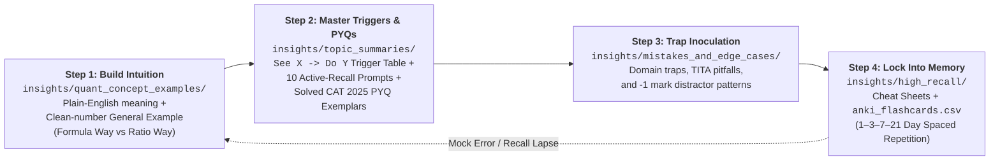
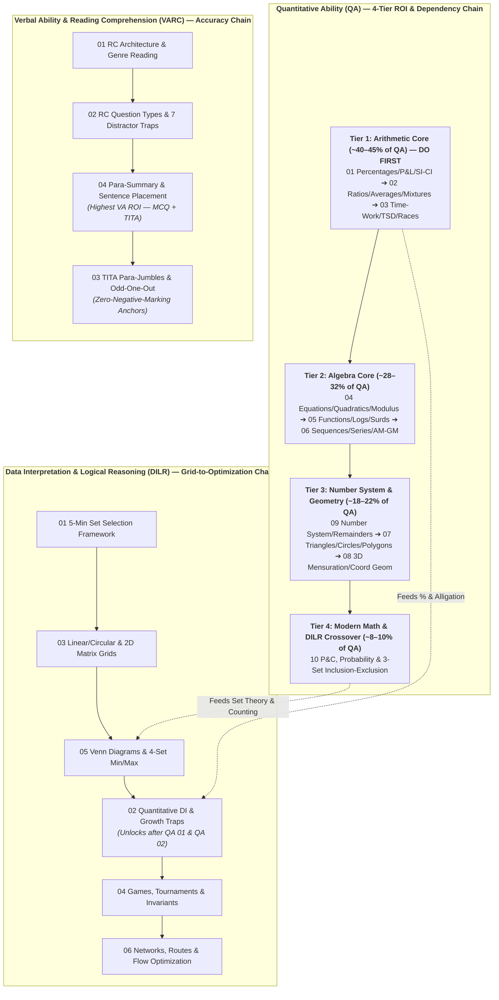
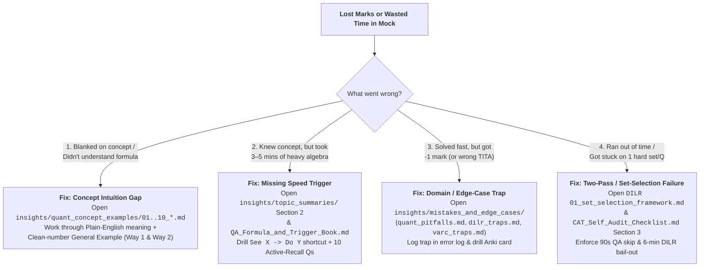

# CAT Preparation Master Study Roadmap, Learning Loop & Diagnostic Flow

> **Quick Links**: [Repository Home (`README.md`)](../README.md) | [Intuitive Quant Concept Examples (`quant_concept_examples/`)](./quant_concept_examples/README.md) | [Topic Summaries (`topic_summaries/`)](./topic_summaries/) | [Trap Compendiums (`mistakes_and_edge_cases/`)](./mistakes_and_edge_cases/) | [Rapid-Revision Cheat Sheets (`high_recall/`)](./high_recall/)

This guide provides a complete, structured roadmap for navigating the **CAT-Prep** repository—whether you are starting from scratch 4 months before the exam, breaking through an 80th-percentile mock plateau, or executing a final 30-day high-recall sprint.

---

## Flow 1: The 4-Step Learning Loop for Any Single Topic (How to Use This Repo)

Never read formula lists passively. Every topic in this repository is engineered around a **4-step active learning loop** that moves you from *plain-English intuition* $\to$ *pattern recognition* $\to$ *trap immunity* $\to$ *long-term retention*.



### Step-by-Step Execution Protocol

| Step | Folder / File to Open | What You Do (25–45 mins per step) | Readiness Gate Before Moving On |
| :--- | :--- | :--- | :--- |
| **Step 1: Build Intuition** | [`insights/quant_concept_examples/`](./quant_concept_examples/README.md) (`01..10_*_examples.md`) | Read **1. Concept & Formula in Plain English** and cover the walkthrough to solve **3. General Example** on scratch paper using both **Way 1 (Formula)** and **Way 2 (Ratio/100s Intuition)**. | You can explain *why* the formula works and solve the clean-number example both ways without looking. |
| **Step 2: Master Triggers & CAT Archetypes** | [`insights/topic_summaries/`](./topic_summaries/) (`quant/`, `dilr/`, `varc/`) | Study **Section 2 (Pattern-Recognition Trigger Table)**, solve all **10 Active-Recall Drill prompts** (`<details>` tags) before clicking to reveal, and work through the **Solved CAT 2025 PYQ Edge Exemplars**. | You score $\ge 8/10$ on the Active-Recall prompts and can spot the `See X -> Do Y` trigger on each CAT 2025 PYQ in under 30 seconds. |
| **Step 3: Trap Inoculation** | [`quant_pitfalls.md`](./mistakes_and_edge_cases/quant_pitfalls.md), [`dilr_traps.md`](./mistakes_and_edge_cases/dilr_traps.md), [`varc_traps.md`](./mistakes_and_edge_cases/varc_traps.md) | Read the boundary conditions and classic exam traps for that module (e.g., $a = 0$ degenerate quadratics, log base $\in (0,1)$ sign-flips, CAGR $n-1$ intervals, RC `Too_Extreme` modals). | You can name the #1 trap for each formula before attempting timed sets. |
| **Step 4: Lock Into Memory** | [`cheat_sheets/`](./high_recall/cheat_sheets/) & [`anki_flashcards.csv`](./high_recall/anki_flashcards.csv) | Review the dense 1-page table in `QA_Formula_and_Trigger_Book.md` / `DILR_Set_Selection_and_Grid_Playbook.md` / `VARC_Elimination_and_VA_Playbook.md` and drill `anki_flashcards.csv` on a **1–3–7–21 day** spaced-repetition cycle. | Instant $< 5$-second recall of every trigger and identity during timed mocks. |

---

## Flow 2: Dependency & ROI-Ordered Module Sequence (Across QA, DILR, and VARC)

Do **not** study chapters in random order. In CAT, Arithmetic ratios power Quantitative DI, Quadratics/Modulus power Functions and Sequences, and 2D Triangle similarity powers 3D Mensuration. Follow the exact dependency and Return-on-Investment (ROI) chains below.



### 2.1 Quantitative Ability (QA) Ordered Module Table

| Tier & Weightage | Order | Topic Summary File | Intuitive Concept Examples File | Why This Order? |
| :--- | :---: | :--- | :--- | :--- |
| **Tier 1: Arithmetic Core**<br/>*(~40–45% of QA; 8–10 Qs/slot)* | **1** | [`01_arithmetic_percentages_pl_sici.md`](./topic_summaries/quant/01_arithmetic_percentages_pl_sici.md) | [`01_arithmetic_percentages_pl_sici_examples.md`](./quant_concept_examples/01_arithmetic_percentages_pl_sici_examples.md) | Multiplying factors ($\text{MF} = 1 \pm \frac{p}{100}$) and base-shift fractions are the language of all Arithmetic and DI. |
| **Tier 1: Arithmetic Core** | **2** | [`02_arithmetic_ratios_averages_mixtures_alligations.md`](./topic_summaries/quant/02_arithmetic_ratios_averages_mixtures_alligations.md) | [`02_arithmetic_ratios_averages_mixtures_alligations_examples.md`](./quant_concept_examples/02_arithmetic_ratios_averages_mixtures_alligations_examples.md) | Ratio scaling and the Alligation lever rule directly speed up P&L, SI/CI, TSD, and DILR weighted tables. |
| **Tier 1: Arithmetic Core** | **3** | [`03_arithmetic_time_work_tsd_races_circular_tracks.md`](./topic_summaries/quant/03_arithmetic_time_work_tsd_races_circular_tracks.md) | [`03_arithmetic_time_work_tsd_races_circular_tracks_examples.md`](./quant_concept_examples/03_arithmetic_time_work_tsd_races_circular_tracks_examples.md) | Applies inverse proportionality ($S \propto 1/T$) and LCM scaling from QA 01–02 to Work, TSD, and Circular Tracks. |
| **Tier 2: Algebra Core**<br/>*(~28–32% of QA; 6–7 Qs/slot)* | **4** | [`04_algebra_equations_polynomials_inequalities_modulus.md`](./topic_summaries/quant/04_algebra_equations_polynomials_inequalities_modulus.md) | [`04_algebra_equations_polynomials_inequalities_modulus_examples.md`](./quant_concept_examples/04_algebra_equations_polynomials_inequalities_modulus_examples.md) | Linear Diophantine equations, Vieta's root relations, Wavy Curve, and Modulus are prerequisites for all higher Algebra. |
| **Tier 2: Algebra Core** | **5** | [`05_algebra_functions_graphs_logs_surds.md`](./topic_summaries/quant/05_algebra_functions_graphs_logs_surds.md) | [`05_algebra_functions_graphs_logs_surds_examples.md`](./quant_concept_examples/05_algebra_functions_graphs_logs_surds_examples.md) | Builds on QA 04 quadratics/inequalities to solve Log domain filters, Surd de-nesting, GIF $\lfloor x \rfloor$, and Cauchy equations. |
| **Tier 2: Algebra Core** | **6** | [`06_algebra_sequences_series_maxima_minima.md`](./topic_summaries/quant/06_algebra_sequences_series_maxima_minima.md) | [`06_algebra_sequences_series_maxima_minima_examples.md`](./quant_concept_examples/06_algebra_sequences_series_maxima_minima_examples.md) | Completes Algebra with AP/GP/AGP, telescoping series, and AM-GM / Cauchy-Schwarz optimization. |
| **Tier 3: Numbers & Geometry**<br/>*(~18–22% of QA; 4–5 Qs/slot)* | **7** | [`09_number_system_divisibility_factors_hcflcm_remainders_bases.md`](./topic_summaries/quant/09_number_system_divisibility_factors_hcflcm_remainders_bases.md) | [`09_number_system_divisibility_factors_hcflcm_remainders_examples.md`](./quant_concept_examples/09_number_system_divisibility_factors_hcflcm_remainders_examples.md) | Prime factorization, divisor counting $d(N)$, HCF/LCM models, and modular arithmetic sharpen integer TITA intuition. |
| **Tier 3: Numbers & Geometry** | **8** | [`07_geometry_triangles_circles_polygons.md`](./topic_summaries/quant/07_geometry_triangles_circles_polygons.md) | [`07_geometry_triangles_circles_polygons_examples.md`](./quant_concept_examples/07_geometry_triangles_circles_polygons.md) | 2D Euclidean geometry: Pythagorean triplets, similarity, Mass Point Geometry, Circle tangents, and Trapeziums/Polygons. |
| **Tier 3: Numbers & Geometry** | **9** | [`08_geometry_mensuration_3d_coordinate_trig.md`](./topic_summaries/quant/08_geometry_mensuration_3d_coordinate_trig.md) | [`08_geometry_mensuration_3d_coordinate_trig_examples.md`](./quant_concept_examples/08_geometry_mensuration_3d_coordinate_trig_examples.md) | Extends 2D similarity and right triangles into 3D cones/spheres/frustums, Shoelace coordinates, and line reflections. |
| **Tier 4: Modern Math**<br/>*(~8–10% of QA; 2–3 Qs/slot)* | **10** | [`10_modern_math_pnc_probability_set_theory.md`](./topic_summaries/quant/10_modern_math_pnc_probability_set_theory.md) | [`10_modern_math_pnc_probability_set_theory_examples.md`](./quant_concept_examples/10_modern_math_pnc_probability_set_theory_examples.md) | Stars & Bars, Derangements, Bayes' Theorem, and 3-Set Inclusion-Exclusion (which directly overlaps with DILR 05!). |

### 2.2 DILR & VARC Ordered Module Table

| Section | Order | Module File | High-Yield Focus & Prerequisite Link |
| :--- | :---: | :--- | :--- |
| **DILR** | **1** | [`01_set_selection_and_5min_scanning_framework.md`](./topic_summaries/dilr/01_set_selection_and_5min_scanning_framework.md) | Master the 5-minute scanning pass, 6-minute bail-out rule, and structural anchor detection before solving sets. |
| **DILR** | **2** | [`03_arrangements_linear_circular_matrix_scheduling.md`](./topic_summaries/dilr/03_arrangements_linear_circular_matrix_scheduling.md) | Build deterministic 2D table-grid habits, bijective row/column elimination, and modular circular seating ($\pmod N$). |
| **DILR** | **3** | [`05_venn_diagrams_set_theory_maxima_minima.md`](./topic_summaries/dilr/05_venn_diagrams_set_theory_maxima_minima.md) | Master 3-Set and 4-Set layer equations ($E_1 + 2E_2 + 3E_3 + 4E_4$) and surplus extrema (pairs with `QA 10`). |
| **DILR** | **4** | [`02_quantitative_di_tables_charts_growth_traps.md`](./topic_summaries/dilr/02_quantitative_di_tables_charts_growth_traps.md) | Apply `QA 01` & `QA 02` ratios to missing-value matrices, waterfall diffs, and index-base traps. |
| **DILR** | **5** | [`04_games_tournaments_knockouts_round_robin.md`](./topic_summaries/dilr/04_games_tournaments_knockouts_round_robin.md) | Knockout match invariants ($N - 1$), Round-Robin $\binom{n}{2}$ point sums, and seeded upsets. |
| **DILR** | **6** | [`06_networks_routes_flows_optimization_puzzles.md`](./topic_summaries/dilr/06_networks_routes_flows_optimization_puzzles.md) | Flow conservation ($\text{In} = \text{Out}$), min-cut bottlenecks, and diophantine coin/weight puzzles. |
| **VARC** | **1** | [`01_rc_reading_architecture_and_genre_guides.md`](./topic_summaries/varc/01_rc_reading_architecture_and_genre_guides.md) | 3-minute structural map (Author's Thesis + Pivot Words + Tone) across Humanities, Economics, and Science genres. |
| **VARC** | **2** | [`02_rc_question_types_and_7_option_elimination_traps.md`](./topic_summaries/varc/02_rc_question_types_and_7_option_elimination_traps.md) | Eliminate `Too_Extreme`, `Out_of_Scope`, `Causal_Inversion`, and `Half_Truth` distractors in 2-contender showdowns. |
| **VARC** | **3** | [`04_va_para_summary_and_sentence_placement.md`](./topic_summaries/varc/04_va_para_summary_and_sentence_placement.md) | Highest-accuracy VA questions: Thesis-match Para-Summary and pronoun/bridge-hook Sentence Placement. |
| **VARC** | **4** | [`03_va_para_jumbles_and_odd_one_out_tita.md`](./topic_summaries/varc/03_va_para_jumbles_and_odd_one_out_tita.md) | Zero-negative-marking TITA strategy: mandatory pairs (`Pronoun -> Referent`, `Contrast Pivot`) and 3-1-Outlier detection. |

---

## Flow 3: 3-Track Study Plans Based on Starting Point & Time Left

Choose the track that matches your current timeline and mock percentile:

### Track A: Full Foundation Track (12–16 Weeks | Starting from Scratch or $< 70\%$ile)

| Phase | Weeks | QA Assignment (4-Step Loop) | DILR Assignment | VARC Assignment | Milestone Check |
| :--- | :---: | :--- | :--- | :--- | :--- |
| **Phase 1: Arithmetic & Reading Core** | **Weeks 1–4** | `QA 01`, `QA 02`, `QA 03` ([Concept Examples](./quant_concept_examples/README.md) $\to$ [Summaries](./topic_summaries/quant/)) | `DILR 01` (Scanning) + `DILR 03` (Arrangements/Grids) + `DILR 02` (Quant DI) | `VARC 01` + `VARC 02` (2 RCs/day using 7-Trap Elimination) | 100% of Arithmetic Active-Recall prompts solved; 1 full mock every 2 weeks. |
| **Phase 2: Algebra & Venn/Tournament Core** | **Weeks 5–8** | `QA 04`, `QA 05`, `QA 06` ([Concept Examples](./quant_concept_examples/README.md) $\to$ [Summaries](./topic_summaries/quant/)) | `DILR 05` (3/4-Set Venn) + `DILR 04` (Games & Tournaments) | `VARC 04` (Para-Summary & Placement) + 2 RCs/day | 1 full mock/week; log every `-1` trap against [`mistakes_and_edge_cases/`](./mistakes_and_edge_cases/). |
| **Phase 3: Numbers, Geometry & Modern Math** | **Weeks 9–12** | `QA 09`, `QA 07`, `QA 08`, `QA 10` ([Concept Examples](./quant_concept_examples/README.md) $\to$ [Summaries](./topic_summaries/quant/)) | `DILR 06` (Networks/Optimization) + Timed 40-min 2-Set drills | `VARC 03` (TITA Para-Jumbles & Odd-One-Out) + Full 40-min sectional drills | Complete [`CAT_Self_Audit_Checklist.md`](./high_recall/CAT_Self_Audit_Checklist.md) Domain Check. |
| **Phase 4: PYQ & High-Recall Sprint** | **Weeks 13–16** | Timed slots from [`CAT_2025_QA_questions.json`](../PYQs/questions/CAT_2025_QA_questions.json) + [`QA_Formula_and_Trigger_Book.md`](./high_recall/cheat_sheets/QA_Formula_and_Trigger_Book.md) | Timed slots from [`CAT_2025_DILR_questions.json`](../PYQs/questions/CAT_2025_DILR_questions.json) | Timed slots from [`CAT_2025_VARC_questions.json`](../PYQs/questions/CAT_2025_VARC_questions.json) | 2 mocks/week + daily 15-min [`anki_flashcards.csv`](./high_recall/anki_flashcards.csv) review. |

---

### Track B: Score-Booster / Plateau Breaker Track (6–8 Weeks | Stuck at $75\text{–}90\%$ile)
*For students who already know basic formulas but run out of time in QA, pick wrong sets in DILR, or lose marks to 50-50 RC traps.*

- **Weeks 1–2 (Arithmetic & DILR Selection Overhaul)**:
  - Skip basic derivations; go straight to **Way 2 (Ratio/Common-Sense Intuition)** in [`01..03_arithmetic_*_examples.md`](./quant_concept_examples/README.md) and **Section 2 (Trigger Tables)** in [`topic_summaries/quant/01..03_*.md`](./topic_summaries/quant/).
  - Enforce the **5-Minute DILR Set Selection Pass** using [`DILR_Set_Selection_and_Grid_Playbook.md`](./high_recall/cheat_sheets/DILR_Set_Selection_and_Grid_Playbook.md): rank all 5 sets before solving a single question.
- **Weeks 3–4 (Algebra Speed & VARC Contender Elimination)**:
  - Drill value-plugging, symmetry, and Wavy Curve triggers in [`04..06_algebra_*.md`](./topic_summaries/quant/) + [`quant_pitfalls.md`](./mistakes_and_edge_cases/quant_pitfalls.md).
  - Practice labeling the exact flaw (`Too_Extreme`, `Scope_Shift`, `Causal_Inversion`) on every eliminated RC option using [`varc_traps.md`](./mistakes_and_edge_cases/varc_traps.md).
- **Weeks 5–6 (Geometry, Numbers & Full CAT 2025 Slot Simulations)**:
  - Drill [`07..10_*.md`](./topic_summaries/quant/) triggers and take all 3 slots of CAT 2025 (`Slot 1`, `Slot 2`, `Slot 3`) from [`PYQs/questions/`](../PYQs/questions/) under strict 40-minute sectional timers.
- **Weeks 7–8 (Mistake Elimination & High-Recall Lock)**:
  - Audit every weak cell in [`CAT_Self_Audit_Checklist.md`](./high_recall/CAT_Self_Audit_Checklist.md) and review all 3 [`cheat_sheets/`](./high_recall/cheat_sheets/) every 48 hours.

---

### Track C: Final 30-Day High-Recall Sprint (4 Weeks Before CAT)

| Week | Primary Daily Focus | Exact Repository Files to Drill |
| :--- | :--- | :--- |
| **Week 1 (Days 1–7)** | **High-Yield Trigger & Trap Sweep** | [`QA_Formula_and_Trigger_Book.md`](./high_recall/cheat_sheets/QA_Formula_and_Trigger_Book.md), [`DILR_Set_Selection_and_Grid_Playbook.md`](./high_recall/cheat_sheets/DILR_Set_Selection_and_Grid_Playbook.md), [`VARC_Elimination_and_VA_Playbook.md`](./high_recall/cheat_sheets/VARC_Elimination_and_VA_Playbook.md) |
| **Week 2 (Days 8–14)** | **Pitfall Inoculation & Active Recall** | [`quant_pitfalls.md`](./mistakes_and_edge_cases/quant_pitfalls.md), [`dilr_traps.md`](./mistakes_and_edge_cases/dilr_traps.md), [`varc_traps.md`](./mistakes_and_edge_cases/varc_traps.md) + all 100 Active-Recall prompts across `topic_summaries/` |
| **Week 3 (Days 15–21)** | **Official CAT 2025 3-Slot Benchmark** | [`CAT_2025_QA_questions.json`](../PYQs/questions/CAT_2025_QA_questions.json), [`CAT_2025_DILR_questions.json`](../PYQs/questions/CAT_2025_DILR_questions.json), [`CAT_2025_VARC_questions.json`](../PYQs/questions/CAT_2025_VARC_questions.json) + [`CAT_2025_Detailed_Analytics_Report.md`](./CAT_2025_Detailed_Analytics_Report.md) |
| **Week 4 (Days 22–30)** | ** Readiness Verification & Flashcard Lock** | [`CAT_Self_Audit_Checklist.md`](./high_recall/CAT_Self_Audit_Checklist.md) + [`anki_flashcards.csv`](./high_recall/anki_flashcards.csv) (zero new heavy topics in the final 72 hours; keep sleep biological clock aligned to your exam slot). |

---

## Flow 4: Daily Balanced Study Block Blueprint (Weekday 3-Hour vs. Weekend 6-Hour)

Never spend an entire week studying only QA while letting VARC and DILR go cold—CAT rewards **daily multi-section rhythm**.

### 4.1 Weekday 3-Hour Balanced Study Block (180 Minutes)

```text
+-----------------------------------------------------------------------------------+
| BLOCK 1: VARC Daily Rhythm (45 mins)                                              |
|  - 2 Timed RC Passages (16 mins) + 4 VA Questions (8 mins)                        |
|  - 21-min Deep Post-Mortem: Tag every wrong option using insights/mistakes_and_   |
|    edge_cases/varc_traps.md (Too_Extreme, Out_of_Scope, Causal_Inversion, etc.)   |
+-----------------------------------------------------------------------------------+
                                         |
                                         v
+-----------------------------------------------------------------------------------+
| BLOCK 2: DILR Timed Set Execution (45 mins)                                       |
|  - Pick 2 sets: 3-min scan -> 15-min solve per set (enforce 6-min bail-out rule!) |
|  - 12-min Grid Audit: Rebuild the cleanest 2D table/Venn representation from      |
|    insights/topic_summaries/dilr/ without time pressure.                          |
+-----------------------------------------------------------------------------------+
                                         |
                                         v
+-----------------------------------------------------------------------------------+
| BLOCK 3: QA Concept + Two-Pass Sprint (75 mins)                                   |
|  - 30 mins: 1 Module slice in insights/quant_concept_examples/ + topic_summaries/ |
|  - 30 mins: 12-question timed drill using the Two-Pass Method (Pass 1: Round_1    |
|    Sitters in <90s; Pass 2: Round_2 Doables)                                      |
|  - 15 mins: Re-solve every missed/slow question using the 30-Second Speed Trigger |
+-----------------------------------------------------------------------------------+
                                         |
                                         v
+-----------------------------------------------------------------------------------+
| BLOCK 4: Spaced-Repetition Recall Lock (15 mins)                                  |
|  - 20 cards from insights/high_recall/anki_flashcards.csv + Cheat Sheet scan      |
+-----------------------------------------------------------------------------------+
```

### 4.2 Weekend 6-Hour Mock + Deep Diagnostic Block (360 Minutes)
1. **Hours 1–2 (120 mins)**: Full-length 2-hour CAT Mock ($40\text{ min VARC} + 40\text{ min DILR} + 40\text{ min QA}$) in your exact exam-slot window.
2. **Hours 3–5 (180 mins)**: **3-Hour Post-Mock Diagnostic Audit** using **Flow 5** below:
   - Re-solve every unattempted `Round_1_Sitter` and every wrong question *before* reading the solution.
   - Audit DILR set selection: Did you find the 2 easiest sets in the first 5 minutes?
3. **Hour 6 (60 mins)**: Targeted remediation in the exact files from `insights/quant_concept_examples/`, `insights/topic_summaries/`, and `insights/mistakes_and_edge_cases/` surfaced by your mock log.

---

## Flow 5: Post-Mock Diagnostic Decision Tree ("Why Did I Lose Marks $\to$ Which File Fixes It?")

After every mock or sectional test, classify each lost mark using this decision tree to jump straight to the file that fixes the root cause:



### Actionable Symptom-to-File Remediation Matrix

| Mock Symptom Observed | Root Cause Diagnosis | Exact Repository File(s) to Open Right Now |
| :--- | :--- | :--- |
| **QA**: Confused by faulty weights, installments, or alligation denominator units | Arithmetic setup gap | [`01_arithmetic_percentages_pl_sici_examples.md`](./quant_concept_examples/01_arithmetic_percentages_pl_sici_examples.md), [`02_arithmetic_ratios_averages_mixtures_alligations_examples.md`](./quant_concept_examples/02_arithmetic_ratios_averages_mixtures_alligations_examples.md) |
| **QA**: Circular track meeting points, shuttle runs, or escalator steps took $> 3$ mins | TSD relative motion gap | [`03_arithmetic_time_work_tsd_races_circular_tracks_examples.md`](./quant_concept_examples/03_arithmetic_time_work_tsd_races_circular_tracks_examples.md), [`03_arithmetic_time_work_tsd_races_circular_tracks.md`](./topic_summaries/quant/03_arithmetic_time_work_tsd_races_circular_tracks.md) |
| **QA**: Got $-1$ on quadratic/modulus inequality, log base, or $\lfloor x \rfloor$ equation | Domain / boundary trap ($a=0$, base $\in (0,1)$, open bracket $\sqrt{n^2+1}$) | [`quant_pitfalls.md`](./mistakes_and_edge_cases/quant_pitfalls.md) (Pitfalls 2.1–2.6), [`04_algebra_*_examples.md`](./quant_concept_examples/04_algebra_equations_polynomials_inequalities_modulus_examples.md), [`05_algebra_*_examples.md`](./quant_concept_examples/05_algebra_functions_graphs_logs_surds_examples.md) |
| **QA**: Missed telescoping sum, AP sum-to-term ratio, or AM-GM split | Missing series/max-min trigger | [`06_algebra_sequences_series_maxima_minima_examples.md`](./quant_concept_examples/06_algebra_sequences_series_maxima_minima_examples.md), [`QA_Formula_and_Trigger_Book.md`](./high_recall/cheat_sheets/QA_Formula_and_Trigger_Book.md) |
| **QA**: Stuck on triangle cevian ratios, inscribed solids, or coordinate reflection | Missing Mass Point / 2D-slice / reflection formula | [`07_geometry_triangles_circles_polygons_examples.md`](./quant_concept_examples/07_geometry_triangles_circles_polygons_examples.md), [`08_geometry_mensuration_3d_coordinate_trig_examples.md`](./quant_concept_examples/08_geometry_mensuration_3d_coordinate_trig_examples.md) |
| **QA**: Confused by remainders, trailing zeros, Stars & Bars, or 3-Set Venn extrema | Number system / P&C / Set formula gap | [`09_number_system_*_examples.md`](./quant_concept_examples/09_number_system_divisibility_factors_hcflcm_remainders_examples.md), [`10_modern_math_*_examples.md`](./quant_concept_examples/10_modern_math_pnc_probability_set_theory_examples.md) |
| **DILR**: Spent 18 mins on an impossible set and solved $< 1.5$ sets total | Set selection & sunk-cost trap | [`01_set_selection_and_5min_scanning_framework.md`](./topic_summaries/dilr/01_set_selection_and_5min_scanning_framework.md), [`DILR_Set_Selection_and_Grid_Playbook.md`](./high_recall/cheat_sheets/DILR_Set_Selection_and_Grid_Playbook.md) |
| **DILR**: Misread "at least / only", percentage points vs $\%$, or circular left/right | DILR wording & constraint trap | [`dilr_traps.md`](./mistakes_and_edge_cases/dilr_traps.md) (Traps 1–6) |
| **VARC**: Narrowed RC down to 2 options and consistently picked the wrong one | Falling for `Too_Extreme`, `Scope_Shift`, or `Half_Truth` | [`02_rc_question_types_and_7_option_elimination_traps.md`](./topic_summaries/varc/02_rc_question_types_and_7_option_elimination_traps.md), [`varc_traps.md`](./mistakes_and_edge_cases/varc_traps.md) |
| **VARC**: Low accuracy on Para-Summary, Sentence Placement, or TITA Para-Jumbles | Missing structural link pairs & thesis check | [`04_va_para_summary_and_sentence_placement.md`](./topic_summaries/varc/04_va_para_summary_and_sentence_placement.md), [`03_va_para_jumbles_and_odd_one_out_tita.md`](./topic_summaries/varc/03_va_para_jumbles_and_odd_one_out_tita.md), [`VARC_Elimination_and_VA_Playbook.md`](./high_recall/cheat_sheets/VARC_Elimination_and_VA_Playbook.md) |
